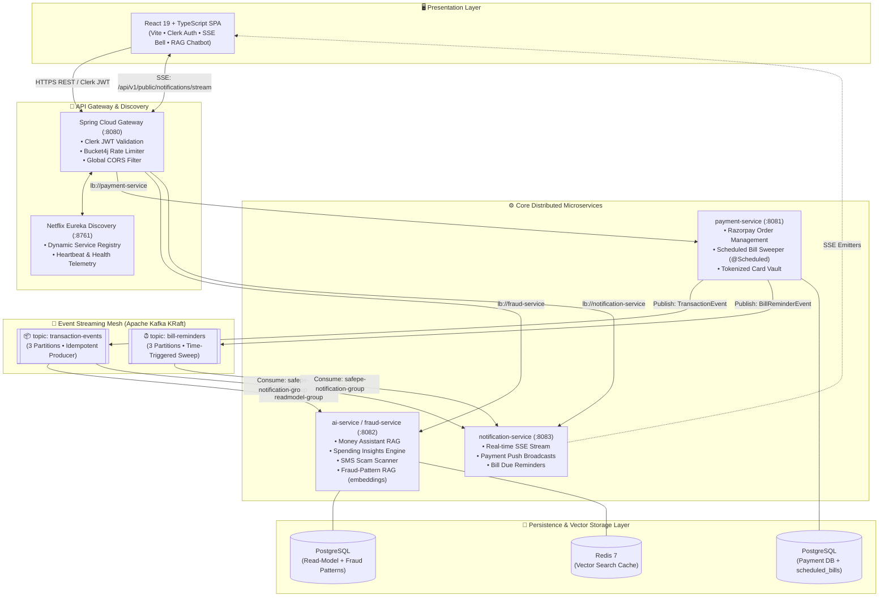
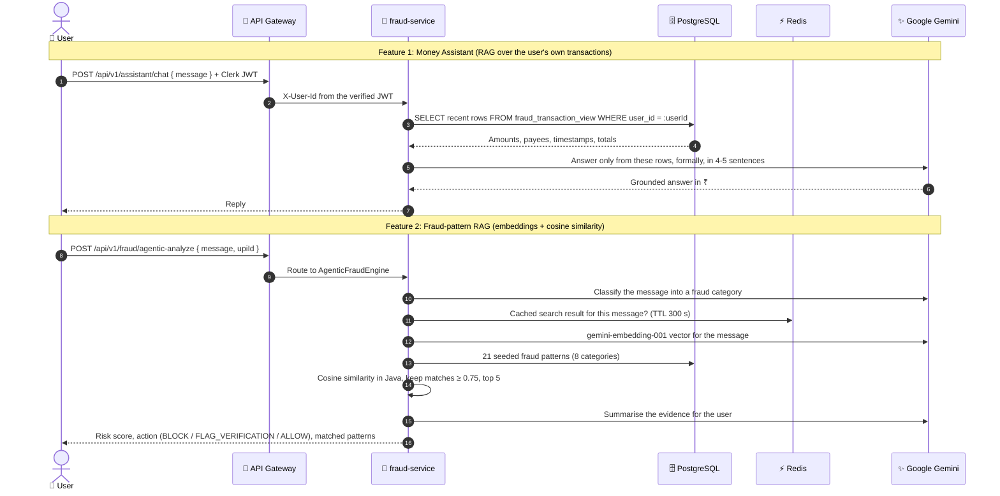

<div align="center">

# 🛡️ SafePe — Distributed AI-Powered UPI Payment Platform

[](https://openjdk.org/)
[](https://spring.io/projects/spring-boot)
[](https://spring.io/projects/spring-cloud)
[-black.svg?style=flat-square&logo=apache-kafka)](https://kafka.apache.org/)
[](https://www.postgresql.org/)
[](https://redis.io/)
[](https://github.com/langchain4j/langchain4j)
[](https://react.dev/)
[](#-rag-evaluation-ragas)
[](LICENSE)

**An event-driven 5-microservice digital payment platform with Gemini-embedding RAG, an AI Money Assistant, semantic scam-pattern trust scoring, scheduled bill reminders (Kafka + SSE), and provider-tokenized card storage.**

[🌐 **Live Demo Application**](http://52.63.132.156:3000) • [💻 **GitHub Repository**](https://github.com/pavansaiambala7/safepe) • [📊 **RAG Evaluation**](#-rag-evaluation-ragas) • [📖 **API Documentation**](#-api-specification) • [🚀 **Quick Start**](#-quick-start)

---

</div>

## 📐 3D System Architecture

<div align="center">
  
</div>

---

## 🏛️ System Overview & Architecture

SafePe is engineered around a **Database-per-Service**, **CQRS Read-Model**, and **Event-Driven Architecture** across 5 decoupled services communicating through an **Apache Kafka (KRaft mode)** bus.

### High-Level Topology



---

## 📦 The 5 Core Microservices

| # | Service Name | Port | Primary Tech Stack | Core Responsibilities |
|---|---|---|---|---|
| **1** | **`eureka-server`** | `8761` | Spring Cloud Netflix Eureka | Service registration, dynamic load balancing lookup, service health heartbeats. |
| **2** | **`api-gateway`** | `8080` | Spring Cloud Gateway, Reactive WebFlux | Clerk JWKS token verification, IP token-bucket rate limiting (Bucket4j), route aggregation for payments, bills, fraud, and notifications. |
| **3** | **`payment-service`** | `8081` | Spring Boot 3.2, JPA, Razorpay SDK | Razorpay order creation, payment signature verification, dynamic UPI QR generation, provider-tokenized card vault, `@Scheduled` bill reminder sweeper. Publishes `transaction-events` & `bill-reminders`. |
| **4** | **`fraud-service`** *(AI Service)* | `8082` | Spring Boot 3.2, LangChain4j, Gemini, Redis | Event read-model consumer, Money Assistant (RAG over user txns), Spending Insights, SMS Scam Scanner, Vector DB Trust & Risk Evaluation Engine. |
| **5** | **`notification-service`** | `8083` | Spring Boot 3.2, Spring MVC SSE | Real-time Server-Sent Events (SSE) notification hub. Consumes `transaction-events` and `bill-reminders` to push instant payment receipt chimes and bill alerts to the UI. |

---

## 🤖 AI Capabilities

SafePe has three Gemini-backed AI features. Two of them are retrieval-augmented (RAG) and are evaluated with RAGAS (see [RAG Evaluation](#-rag-evaluation-ragas)).



### 1. 💬 Money Assistant
- **Endpoints:** `POST /api/v1/assistant/chat`, `POST /api/v1/assistant/money`
- **How it works:** retrieves the signed-in user's recent transactions from the `fraud_transaction_view` read model and makes one Gemini call that may only use those rows. The user id always comes from the verified JWT, never from the request body.
- **Reply style:** formal, 4 to 5 complete sentences in one paragraph, no greetings, emojis, bullet points or Markdown. Amounts are in ₹. The chat UI renders replies in a clean chat font.
- **Example questions:** *"How much did I spend this month?"*, *"What was my biggest transaction?"*, *"How can I save ₹5,000?"*

### 2. 📊 Spending Insights
- **Endpoint:** `GET /api/v1/assistant/insights` (user taken from the JWT)
- **How it works:** totals the user's spending, counts transactions, ranks the top 5 payees and asks Gemini for a short factual summary. The donut chart and payee breakdown are drawn from these real numbers.
- **New users start at ₹0:** with no transactions the page shows ₹0, 0 transactions and "No spending yet". There is no sample data.

### 3. 🔍 Fraud-Pattern RAG
- **Endpoints:** `POST /api/v1/fraud/agentic-analyze`, `GET /api/v1/fraud/patterns/search?query=...`
- **Retrieval:** the message is embedded with `gemini-embedding-001` and compared by cosine similarity (computed in Java) against 21 seeded patterns in 8 categories: phishing, KYC fraud, UPI fraud, loan scam, lottery scam, investment fraud, impersonation and vishing. Matches at or above the **0.75** threshold are kept, top 5. Results are cached in Redis for 300 seconds; a cache hit takes about 8 ms.
- **Scoring:** a match gives a risk score of 75–99 (action `BLOCK` at 85 or above, otherwise `FLAG_VERIFICATION`). No match gives a risk score of 15 and `ALLOW`.

### 4. 🛡️ SMS Scam Scanner
- **Endpoint:** `POST /api/v1/fraud/analyze-sms`
- **How it works:** a single Gemini prompt (not RAG) that always replies as `Risk Score: N/100`, `Verdict: Scam / Suspicious / Safe` and a one-sentence reason.
- **Colour-coded score in the UI:**

| Risk score | Colour | Label |
|---|---|---|
| 70–100 | 🔴 Red | High Risk |
| 31–69 | 🔵 Blue | Moderate Risk |
| 0–30 | 🟢 Green | Safe |

### 5. ⏰ Scheduled Bill / EMI / Recharge Reminders (Kafka + SSE)
- **Mechanism:** `@Scheduled(cron = "0 0 9 * * *")` sweep in `payment-service` finds bills due within 3 days, publishes `BillReminderEvent` to the `bill-reminders` Kafka topic, and `notification-service` pushes it to the browser over SSE.
- **Manual trigger:** `POST /api/v1/bills/run-reminders` (replayable; does not mark bills as notified).

### 6. 🔔 Notifications & Kafka Event Monitor
- The notification bell and the **Kafka Event Monitor** page show only real events received from `transaction-events` and `bill-reminders`. There are no demo notifications, demo transactions or simulated event streams; a new user sees empty states until they make a payment.

---

## 📊 RAG Evaluation (RAGAS)

Both RAG pipelines were evaluated with [RAGAS](https://docs.ragas.io/) 0.4.3, using a Gemini Flash model as the judge, against the local Docker stack. The code, test sets and full per-question results are in [`rag-eval/`](rag-eval/) ([full report](rag-eval/results/full_report.md)).

**Fraud-pattern RAG**: 18 cases (12 scam paraphrases, 6 legitimate look-alikes)

| Metric | Score |
|---|---|
| Scams caught | **12 / 12** |
| False positives | **0 / 6** |
| Top-1 category correct | **12 / 12** |
| Faithfulness | 0.771 |
| Answer relevancy | 0.662 |
| Context precision | 0.750 |

**Money Assistant**: 10 questions over a seeded transaction history

| Metric | Score |
|---|---|
| Answers correct (manual review) | **10 / 10** |
| Faithfulness | 0.725 |
| Answer relevancy | 0.940 |
| Factual correctness | 0.610 |
| Context recall | 1.000 |

**Limits of this evaluation** (details in the report's reviewer notes):
- The test sets are small.
- The 0.75 similarity threshold was tuned on the same fraud set, so 12/12 is an optimistic estimate.
- Fraud context recall is 0 because of how the reference answers were written, not because retrieval failed.
- The Money Assistant was evaluated before replies were changed to the formal 4–5 sentence style.
- A few judge scores are judge errors. All 10 Money Assistant answers were checked by hand and are correct.

---

## ⚡ Event-Driven Lifecycle (CQRS Flow)

```
[Payment Checkout]
       │
       ▼
1. PaymentService.createPaymentOrder()
       │
       ├── Save PENDING Transaction (Postgres OLTP)
       │
       └── Publish TransactionEvent (Kafka 'transaction-events')
                │
                ├──▶ 2. PaymentEventConsumer (AI Service)
                │         └── Ingest into local read-model (Postgres AI DB)
                │
                └──▶ 3. NotificationConsumer (Notification Service)
                          └── Push SSE event ("Payment of ₹X successful")

[Time-Triggered Bill Sweeper]
       │
       ▼
1. @Scheduled (daily 9 AM or POST /api/v1/bills/run-reminders)
       │
       └── Query scheduled_bills due within 3 days
                │
                └── Publish BillReminderEvent (Kafka 'bill-reminders')
                          │
                          └──▶ 2. BillReminderConsumer (Notification Service)
                                    └── Push SSE event ("💳 HDFC Card due in 3 days")
```

---

## 🔒 Security & Data Protection Architecture

- **Clerk JWT Verification:** Stateless cryptographic signature validation at the API Gateway using Clerk JWKS public keys.
- **Bucket4j Token Bucket:** In-memory token-bucket rate limiting at the gateway (`RateLimitFilter`), keyed per authenticated user and falling back to client IP. Tiered per route: Gemini-backed endpoints get 1 req/s (burst 3), payment endpoints 5 req/s (burst 10), read endpoints 30 req/s (burst 60). Returns `429` with `Retry-After` and `X-RateLimit-*` headers. The SSE stream is exempt.
- **Uniform error contract:** Every tier returns the same `ApiError` envelope (`code`, `message`, `status`, `path`, `traceId`, `timestamp`, optional `fieldErrors`). Stack traces and raw exception messages are never returned; the `traceId` correlates the response to the full trace in the logs.
- **Bean-validated request DTOs:** Money-moving endpoints bind to validated records (UPI id, IFSC, account-number and amount-range constraints) rather than untyped maps, so malformed input is rejected with a `400` naming the field.
- **Provider tokenization, no PAN at rest:** Cards, UPI ids and bank accounts are stored as a Razorpay token plus the last four digits (`TokenizationService`). Full card numbers are never persisted.

> **Note:** earlier revisions of this README described an "AES-256 GCM Tokenization Vault" encrypting values at rest. No such encryption was ever implemented — the vault stores provider tokens and masked identifiers, as described above. The unused `VAULT_MASTER_KEY` setting has been removed rather than left in place implying protection it did not provide.

> **Known limitation:** the SSE stream `/api/v1/public/notifications/stream` is unauthenticated and `notification-service` broadcasts every event to every connected browser. Per-user delivery (sending each event only to the user it belongs to) is still to be done.

---

## 📡 API Specification

All endpoints except the SSE stream require a Clerk session token. The gateway verifies it and passes the user id to the services; no endpoint accepts a `userId` from the caller.

### Payment & Bill Service (`/api/v1/payments/**`, `/api/v1/bills/**`, `/api/v1/vault/**`)

```bash
# 1. Create a Razorpay UPI payment order
curl -X POST http://localhost:8080/api/v1/payments/create \
  -H "Content-Type: application/json" \
  -H "Authorization: Bearer <CLERK_JWT>" \
  -d '{"amount": 1500.00, "upiId": "merchant@oksbi"}'

# 2. Create a scheduled bill / EMI for the signed-in user
curl -X POST http://localhost:8080/api/v1/bills \
  -H "Content-Type: application/json" \
  -H "Authorization: Bearer <CLERK_JWT>" \
  -d '{"type": "CC_BILL", "payeeName": "HDFC Credit Card", "amount": "12300", "dueDate": "2026-12-01"}'

# 3. Trigger bill reminders now (Kafka + SSE)
curl -X POST http://localhost:8080/api/v1/bills/run-reminders \
  -H "Authorization: Bearer <CLERK_JWT>"

# 4. Generate a dynamic UPI QR code
curl -X POST http://localhost:8080/api/v1/payments/qr/generate \
  -H "Content-Type: application/json" \
  -H "Authorization: Bearer <CLERK_JWT>" \
  -d '{"amount": 499.00, "description": "Coffee & Snacks"}'
```

### AI Service (`/api/v1/assistant/**`, `/api/v1/fraud/**`)

```bash
# 1. Money Assistant chat
curl -X POST http://localhost:8080/api/v1/assistant/chat \
  -H "Content-Type: application/json" \
  -H "Authorization: Bearer <CLERK_JWT>" \
  -d '{"message": "How much have I spent this month?"}'

# 2. Spending insights
curl http://localhost:8080/api/v1/assistant/insights \
  -H "Authorization: Bearer <CLERK_JWT>"

# 3. Fraud-pattern RAG analysis
curl -X POST http://localhost:8080/api/v1/fraud/agentic-analyze \
  -H "Content-Type: application/json" \
  -H "Authorization: Bearer <CLERK_JWT>" \
  -d '{"message": "Your KYC has expired, update now at bit.ly/kyc-upd or your account will be blocked", "upiId": "kyc.update@ybl"}'

# 4. SMS scam scanner
curl -X POST http://localhost:8080/api/v1/fraud/analyze-sms \
  -H "Content-Type: application/json" \
  -H "Authorization: Bearer <CLERK_JWT>" \
  -d '{"content": "Dear customer, your electricity power will be disconnected tonight. Call 9876543210 immediately."}'
```

### Notification Service (`/api/v1/public/notifications/**`)

```bash
# Subscribe to the live SSE event stream
curl -N http://localhost:8080/api/v1/public/notifications/stream
```

---

## 🚀 Quick Start

### Prerequisites
- **Docker & Docker Compose** (v24+)
- **Java 17+** & **Maven**
- **Node.js 18+**

### 1. Clone & Configure Environment
```bash
git clone https://github.com/pavansaiambala7/safepe.git
cd safepe

# Copy environment template
cp .env.example .env
```

Set the required environment keys in `.env`. Compose refuses to start if any of
these are missing — there are deliberately no fallback defaults for secrets:
```env
POSTGRES_PASSWORD=pick_something_long
RAZORPAY_KEY_ID=rzp_test_your_key_id
RAZORPAY_KEY_SECRET=your_razorpay_secret
RAZORPAY_WEBHOOK_SECRET=your_razorpay_webhook_secret
GEMINI_API_KEY=your_google_gemini_api_key
VITE_CLERK_PUBLISHABLE_KEY=pk_test_your_clerk_key

# Only needed if the SPA is served from an origin other than the bundled nginx
CORS_ALLOWED_ORIGINS=http://localhost:3000
```

> `VITE_*` values are compiled into the JavaScript bundle at **image build time**,
> not read at container start. Changing one requires
> `docker compose build frontend`, not just a restart. The variable is
> `VITE_CLERK_PUBLISHABLE_KEY` — earlier revisions used `VITE_VITE_...`, which
> never reached the bundle and left the app on a "Missing Clerk Key" screen.

### 2. Run Full Stack with Docker Compose
```bash
# Build and start all 5 microservices + Postgres + Redis + Kafka + nginx SPA
docker compose build
docker compose up -d

# Schema is created by Flyway (db/migration/V1__init.sql in each service).
# Hibernate runs with ddl-auto=validate and will refuse to start on drift.
```

### 3. Verify Health & Access
- **Frontend SPA:** `http://localhost:3000` — served by nginx, which also reverse-proxies `/api` to the gateway, so the SPA and API share one origin (no browser CORS).
  In Vite dev mode (`npm run dev`) it is `http://localhost:5173`, proxied by `vite.config.ts`.
- **Eureka Service Registry:** `http://localhost:8761`
- **Spring Cloud Gateway:** `http://localhost:8080`

---

## 🧪 Local Build & Test Verification

```bash
# Compile and package all Spring Boot modules
mvn clean package -DskipTests   # or mvnw.cmd on Windows

# Build React production bundle
cd frontend && npm install && npm run build
```

---

## 📂 Project Structure

```
safepe/
├── api-gateway/            # Spring Cloud Gateway (8080) + Clerk JWT + Rate Limiter
├── eureka-server/          # Netflix Eureka Service Discovery (8761)
├── payment-service/        # Razorpay Orders, Bills Scheduler, Token Vault (8081)
├── fraud-service/          # AI Service: Money Assistant, Insights, Scam Scanner, Fraud RAG (8082)
├── notification-service/   # Real-time Server-Sent Events (SSE) Stream (8083)
├── frontend/               # React 19 + TypeScript + Vite (RAG Assistant + SSE Bell)
├── rag-eval/               # RAGAS evaluation of the Fraud RAG and Money Assistant
├── docs/                   # Architecture visuals & deployment guide (PDF)
├── docker-compose.yml      # Multi-container orchestration (KRaft Kafka, PostgreSQL 15, Redis)
└── pom.xml                 # Multi-module Maven root aggregator
```
