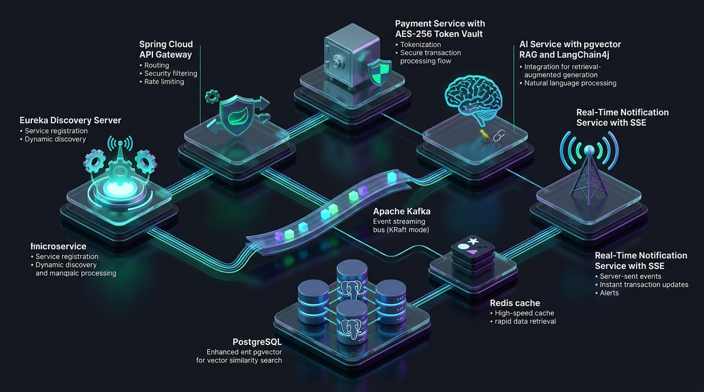
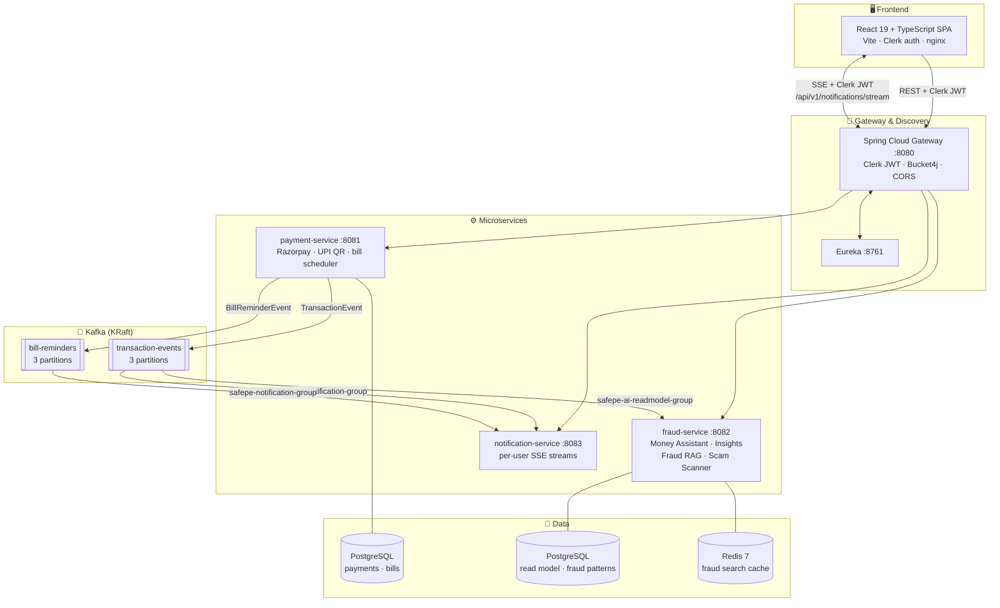
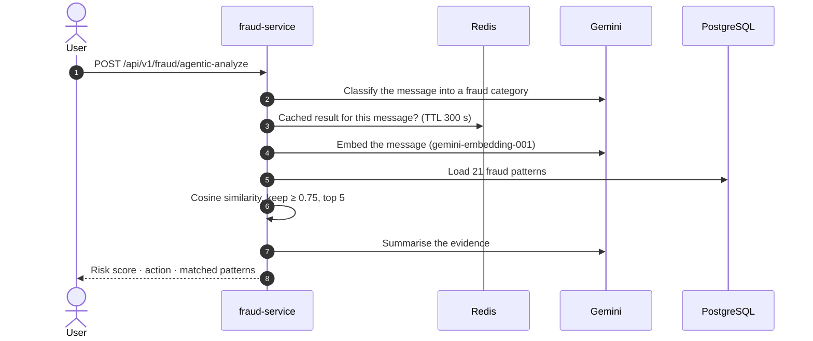

<div align="center">

# 🛡️ SafePe

### Distributed, AI-powered UPI payment platform

[](https://openjdk.org/)
[](https://spring.io/projects/spring-boot)
[](https://spring.io/projects/spring-cloud)
[-black.svg?style=flat-square&logo=apache-kafka)](https://kafka.apache.org/)
[](https://www.postgresql.org/)
[](https://redis.io/)
[](https://github.com/langchain4j/langchain4j)
[](https://react.dev/)
[](#-rag-evaluation)

Five Spring Boot microservices connected by Kafka, with a Gemini Money Assistant, embedding-based scam detection, per-user real-time notifications and Razorpay payments.

[🌐 **Live Demo**](http://52.63.132.156:3000) · [📊 **RAG Evaluation**](#-rag-evaluation) · [📡 **API**](#-api-reference) · [🚀 **Quick Start**](#-quick-start) · [☁️ **Deploy**](#%EF%B8%8F-deploying-to-aws-ec2)

</div>

---

## 📑 Contents

- [Highlights](#-highlights)
- [Architecture](#-architecture)
- [Features](#-features)
- [RAG Evaluation](#-rag-evaluation)
- [Event Flow](#-event-flow)
- [Security](#-security)
- [API Reference](#-api-reference)
- [Quick Start](#-quick-start)
- [Deploying to AWS EC2](#%EF%B8%8F-deploying-to-aws-ec2)
- [Testing](#-testing)
- [Project Structure](#-project-structure)

---

## ✨ Highlights

| | |
|---|---|
| 🔍 **Fraud-pattern RAG** | Caught **12 / 12** test scams with **0 / 6** false positives (RAGAS evaluation) |
| 💬 **Money Assistant** | **10 / 10** answers correct about the user's own spending |
| 📚 **Fraud knowledge base** | 21 scam patterns in 8 categories, matched with `gemini-embedding-001` |
| ⚡ **Redis cache** | Repeat fraud lookups served from cache in about **8 ms** |
| 🔔 **Real-time** | Kafka events pushed to the browser over SSE, **only to the user they belong to** |
| 🧱 **Microservices** | 5 services behind one gateway, database per service, Eureka discovery |

---

## 🏛️ Architecture

<div align="center">
  
</div>

SafePe uses **database-per-service**, a **CQRS read model** and **event-driven** communication over **Apache Kafka (KRaft mode)**.



### Services

| Service | Port | Stack | Responsibilities |
|---|---|---|---|
| `eureka-server` | 8761 | Spring Cloud Netflix Eureka | Service registry and health heartbeats |
| `api-gateway` | 8080 | Spring Cloud Gateway (WebFlux) | Verifies the Clerk JWT, sets `X-User-Id`, per-user Bucket4j rate limits, routing |
| `payment-service` | 8081 | Spring Boot, JPA, Razorpay SDK | Payment orders and signature verification, UPI QR, tokenized cards, daily bill sweep. Publishes both Kafka topics |
| `fraud-service` | 8082 | Spring Boot, LangChain4j, Gemini, Redis | Read model from Kafka, Money Assistant, Spending Insights, Fraud-pattern RAG, SMS Scam Scanner |
| `notification-service` | 8083 | Spring Boot, Spring MVC SSE | Consumes both topics and pushes each event to its owner's open browser tabs |

---

## 🤖 Features

### 💬 Money Assistant (RAG over your own transactions)

- **Endpoints:** `POST /api/v1/assistant/chat`, `POST /api/v1/assistant/money`
- **Retrieval:** reads the signed-in user's recent transactions from the `fraud_transaction_view` read model. One Gemini call answers using only those rows.
- **Reply style:** formal, 4 to 5 sentences in one paragraph, amounts in ₹, no greetings, emojis or Markdown.
- **Try:** *"How much did I spend this month?"*, *"What was my biggest transaction?"*, *"How can I save ₹5,000?"*

### 📊 Spending Insights

- **Endpoint:** `GET /api/v1/assistant/insights`
- Total spent, transaction count and top 5 payees, plus a short Gemini summary. The donut chart and payee breakdown use these real figures.
- A new user starts at **₹0** with "No spending yet". No sample data is shown.

### 🔍 Fraud-Pattern RAG



- **Endpoints:** `POST /api/v1/fraud/agentic-analyze`, `GET /api/v1/fraud/patterns/search?query=...`
- **Knowledge base:** 21 patterns covering phishing, KYC fraud, UPI fraud, loan scams, lottery scams, investment fraud, impersonation and vishing.
- **Scoring:** a match at or above 0.75 gives risk 75–99. Risk 85 or more is `BLOCK`, otherwise `FLAG_VERIFICATION`. No match gives risk 15 and `ALLOW`.

### 🛡️ SMS Scam Scanner

- **Endpoint:** `POST /api/v1/fraud/analyze-sms`
- A single Gemini prompt (not RAG) that replies as `Risk Score: N/100`, a verdict (Scam, Suspicious or Safe) and a one-sentence reason. The UI colours the score:

| Risk score | Colour | Label |
|---|---|---|
| 70–100 | 🔴 Red | High Risk |
| 31–69 | 🔵 Blue | Moderate Risk |
| 0–30 | 🟢 Green | Safe |

### ⏰ Bill, EMI & Recharge Reminders

- A daily sweep (`@Scheduled`, 9 AM) in `payment-service` finds bills due within 3 days and publishes them to `bill-reminders`. `notification-service` then pushes each reminder to its owner.
- `POST /api/v1/bills/run-reminders` triggers the sweep on demand without marking bills as notified.

### 🔔 Notifications & Kafka Event Monitor

- The notification bell and the **Kafka Event Monitor** page show only real events from `transaction-events` and `bill-reminders`.
- Each user receives only their own events. Notification history is kept per user in the browser.
- There are no demo transactions, notifications or simulated streams, so a new account starts empty.

---

## 📊 RAG Evaluation

Both RAG pipelines were evaluated with [RAGAS](https://docs.ragas.io/) 0.4.3, using Gemini Flash as the judge, against the local Docker stack. Code, test sets and per-question results are in [`rag-eval/`](rag-eval/), and the [full report](rag-eval/results/full_report.md) has every score.

<table>
<tr><th>Fraud-pattern RAG<br/><sub>18 cases: 12 scams, 6 legitimate look-alikes</sub></th><th>Money Assistant<br/><sub>10 questions over 11 seeded transactions</sub></th></tr>
<tr><td>

| Metric | Score |
|---|---|
| Scams caught | **12 / 12** |
| False positives | **0 / 6** |
| Top-1 category correct | **12 / 12** |
| Faithfulness | 0.771 |
| Answer relevancy | 0.662 |
| Context precision | 0.750 |

</td><td>

| Metric | Score |
|---|---|
| Answers correct (checked by hand) | **10 / 10** |
| Faithfulness | 0.725 |
| Answer relevancy | 0.940 |
| Factual correctness | 0.610 |
| Context recall | 1.000 |

</td></tr>
</table>

**Limits of this evaluation:**
- The test sets are small.
- The 0.75 threshold was tuned on the same fraud cases, so 12/12 is an optimistic estimate.
- Fraud context recall scored 0 because of how the reference answers were written, not because retrieval failed.
- Some low judge scores are judge errors; the report's reviewer notes list them.
- The Money Assistant was evaluated before replies switched to the formal 4–5 sentence style.

---

## ⚡ Event Flow

```
Payment checkout
  └─ payment-service: save transaction → publish TransactionEvent  (transaction-events)
       ├─ fraud-service         PaymentEventConsumer       → update read model (Money Assistant, Insights)
       └─ notification-service  NotificationKafkaConsumer  → "Payment of ₹X successful" → that user's SSE stream

Daily 9 AM sweep (or POST /api/v1/bills/run-reminders)
  └─ payment-service: bills due within 3 days → publish BillReminderEvent  (bill-reminders)
       └─ notification-service  BillReminderConsumer       → "💳 HDFC Card due in 2 days" → that user's SSE stream
```

---

## 🔒 Security

- **Clerk JWT at the gateway:** the gateway verifies every request's signature against Clerk's JWKS keys and passes the user id downstream as `X-User-Id`. Any client-sent `X-User-Id` is removed. Services never take a `userId` from the request.
- **Per-user notifications:** the SSE stream requires the JWT. `notification-service` keeps connections per user and sends each event only to its owner. The browser reads the stream with `fetch` so it can send the token.
- **Rate limiting (Bucket4j):** per-user token buckets by route: AI endpoints 1 req/s (burst 3), payments 5 req/s (burst 10), reads 30 req/s (burst 60). Over-limit requests get `429` with `Retry-After`.
- **No card numbers stored:** cards, UPI ids and bank accounts are stored as a Razorpay token plus the last 4 digits.
- **Validated input:** money-moving endpoints use bean-validated DTOs (UPI id, IFSC, account number, amount range). Bad input gets a `400` naming the field.
- **One error format:** every service returns the same `ApiError` body (`code`, `message`, `status`, `path`, `traceId`, `timestamp`). Stack traces are never exposed.
- **Private infrastructure:** PostgreSQL, Redis and Kafka listen on loopback only, and the services are reachable only through the gateway.

---

## 📡 API Reference

Every endpoint requires `Authorization: Bearer <CLERK_JWT>` except health checks, the Razorpay webhook, fraud-pattern search and `/api/v1/public/**`.

| Method | Path | Purpose |
|---|---|---|
| `POST` | `/api/v1/payments/create` | Create a Razorpay UPI payment order |
| `POST` | `/api/v1/payments/qr/generate` | Generate a dynamic UPI QR code |
| `GET` | `/api/v1/history/transactions` | The user's transaction history |
| `GET` / `POST` | `/api/v1/bills` | List or create the user's scheduled bills |
| `POST` | `/api/v1/bills/run-reminders` | Run the bill reminder sweep now |
| `POST` | `/api/v1/assistant/chat` | Money Assistant |
| `GET` | `/api/v1/assistant/insights` | Spending insights |
| `POST` | `/api/v1/fraud/agentic-analyze` | Fraud-pattern RAG analysis |
| `POST` | `/api/v1/fraud/analyze-sms` | SMS scam scanner |
| `GET` | `/api/v1/notifications/stream` | The user's real-time notification stream (SSE) |

<details>
<summary><b>Example requests</b></summary>

```bash
TOKEN="<CLERK_JWT>"

# Create a payment order
curl -X POST http://localhost:8080/api/v1/payments/create \
  -H "Authorization: Bearer $TOKEN" -H "Content-Type: application/json" \
  -d '{"amount": 1500.00, "upiId": "merchant@oksbi"}'

# Schedule a bill
curl -X POST http://localhost:8080/api/v1/bills \
  -H "Authorization: Bearer $TOKEN" -H "Content-Type: application/json" \
  -d '{"type": "CC_BILL", "payeeName": "HDFC Credit Card", "amount": "12300", "dueDate": "2026-12-01"}'

# Ask the Money Assistant
curl -X POST http://localhost:8080/api/v1/assistant/chat \
  -H "Authorization: Bearer $TOKEN" -H "Content-Type: application/json" \
  -d '{"message": "How much have I spent this month?"}'

# Check a message against the fraud patterns
curl -X POST http://localhost:8080/api/v1/fraud/agentic-analyze \
  -H "Authorization: Bearer $TOKEN" -H "Content-Type: application/json" \
  -d '{"message": "Your KYC has expired, update now at bit.ly/kyc-upd or your account will be blocked", "upiId": "kyc.update@ybl"}'

# Scan an SMS
curl -X POST http://localhost:8080/api/v1/fraud/analyze-sms \
  -H "Authorization: Bearer $TOKEN" -H "Content-Type: application/json" \
  -d '{"content": "Your electricity will be disconnected tonight. Call 9876543210 immediately."}'

# Listen for your notifications
curl -N http://localhost:8080/api/v1/notifications/stream -H "Authorization: Bearer $TOKEN"
```

</details>

---

## 🚀 Quick Start

**Prerequisites:** Docker with Compose v2 (v24+). Java 17, Maven and Node.js 18+ are needed only to build outside Docker.

**1. Clone and configure**

```bash
git clone https://github.com/pavansaiambala7/safepe.git
cd safepe
cp .env.example .env
```

Fill in `.env`. Compose refuses to start if a secret is missing; there are no fallback defaults.

```env
POSTGRES_PASSWORD=pick_something_long
RAZORPAY_KEY_ID=rzp_test_your_key_id
RAZORPAY_KEY_SECRET=your_razorpay_secret
RAZORPAY_WEBHOOK_SECRET=your_razorpay_webhook_secret
GEMINI_API_KEY=your_google_gemini_api_key
VITE_CLERK_PUBLISHABLE_KEY=pk_test_your_clerk_key
CORS_ALLOWED_ORIGINS=http://localhost:3000   # only if the SPA is served from another origin
```

> `VITE_*` values are compiled into the frontend at **image build time**. After changing one, run `docker compose build frontend`; a restart alone is not enough.

**2. Build and run**

```bash
docker compose build
docker compose up -d
```

Flyway creates each database schema on startup, and Hibernate validates it.

**3. Open**

| What | URL |
|---|---|
| App (nginx serves the SPA and proxies `/api` to the gateway) | http://localhost:3000 |
| API gateway | http://localhost:8080 |
| Eureka dashboard | http://localhost:8761 |

For frontend development, `cd frontend && npm install && npm run dev` serves on http://localhost:5173 and proxies `/api` to the gateway.

---

## ☁️ Deploying to AWS EC2

The live demo runs the same Docker Compose stack on a single EC2 instance. Step-by-step setup is in the [deployment guide (PDF)](docs/SafePe-Deployment-Guide.pdf). To update a running server:

```bash
git pull
docker compose build
docker compose up -d
```

To rebuild only what changed, name the services, for example `docker compose build frontend fraud-service`, then `docker compose up -d --force-recreate frontend fraud-service`.

---

## 🧪 Testing

Every push and pull request runs the full test suite and the frontend build on GitHub Actions ([`ci.yml`](.github/workflows/ci.yml)).

| Kind | What it checks | Tools |
|---|---|---|
| Unit | Fraud risk scoring, vector search and caching, insights totals, Money Assistant prompts, payment orders and signatures, bill reminder window, Kafka message handling | JUnit 5, Mockito, AssertJ |
| Web slice | Request validation, error format, user id taken only from the gateway header | `@WebMvcTest`, MockMvc |
| Database | Flyway migrations on real PostgreSQL 15, entities validated against the schema, repository queries | `@DataJpaTest`, Testcontainers |
| Integration | Real Kafka → notification-service → SSE: each event reaches only its owner | `@SpringBootTest`, Testcontainers, JDK `HttpClient` |
| Gateway | JWT signature, issuer and expiry checks against a local JWKS server; rate limits and `429` | Reactor test, JDK `HttpServer` |
| Architecture | Controller → service → repository layering; constructor injection only (no `@Autowired`, no injected fields), in tests too | ArchUnit |

Run them locally with Docker only (no JDK needed):

```bash
scripts/test.sh                      # all services
scripts/test.sh -pl fraud-service    # one service
```

With JDK 17 installed you can run `./mvnw verify` directly. Coverage reports are written to `<service>/target/site/jacoco/index.html`.

Tests marked `@Disabled("Known bug, fixed in Phase N …")` describe correct behaviour that the code does not have yet. Each is switched on when its fix lands.

---

## 📂 Project Structure

```
safepe/
├── api-gateway/            Spring Cloud Gateway: Clerk JWT, rate limits, routing (8080)
├── eureka-server/          Service discovery (8761)
├── payment-service/        Razorpay payments, UPI QR, cards, bill scheduler (8081)
├── fraud-service/          Money Assistant, Insights, Fraud RAG, Scam Scanner (8082)
├── notification-service/   Kafka consumers and per-user SSE streams (8083)
├── frontend/               React 19 + TypeScript + Vite SPA, served by nginx
├── rag-eval/               RAGAS evaluation: test sets, runner and results
├── docs/                   Architecture images and deployment guide
├── scripts/test.sh         Run all backend tests in Docker
├── .github/workflows/      CI: backend tests + frontend build
├── docker-compose.yml      Full stack: services, PostgreSQL 15, Redis 7, Kafka (KRaft)
└── pom.xml                 Maven multi-module parent
```
